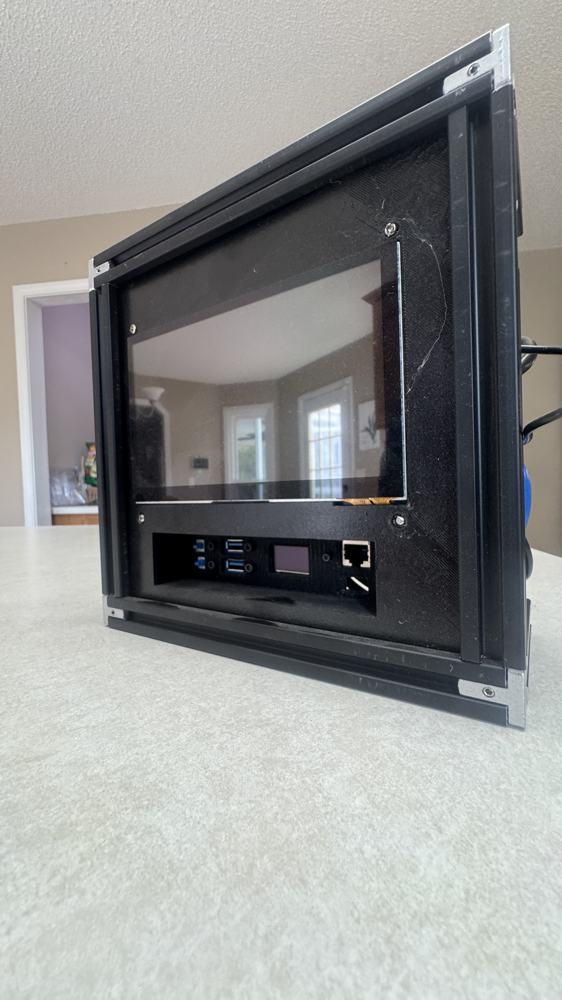
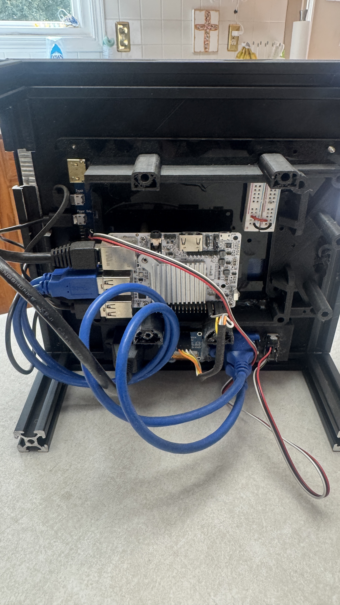
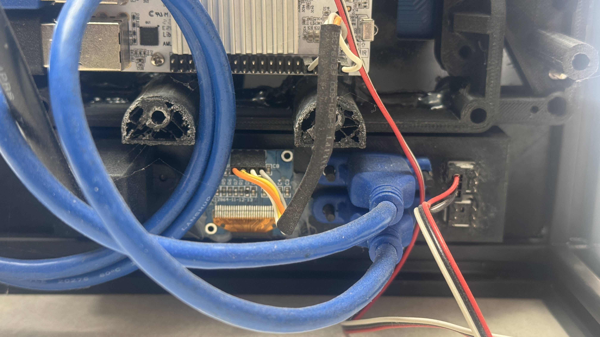

<div align="center">

# 🥔 Le Potato HMI
### Cdaprod · Embedded Systems Lab

**A hardware testing, MQTT messaging and observability dashboard with expressive, event-driven eyes.**

[](https://github.com/Cdaprod/le-potato-human-machine-interface/actions/workflows/ci.yml)
[](https://github.com/Cdaprod/le-potato-human-machine-interface/actions/workflows/docker.yml)
[](LICENSE)
[](pyproject.toml)
[](Dockerfile)

**[Quick start](#quick-start--docker-compose)** · **[Architecture](#architecture)** · **[Hardware](#the-hardware)** · **[Cdaprod ecosystem](#cdaprod-ecosystem)** · **[Contribute](#community)**

</div>

---

> **Build hardware. Understand its behavior. Make infrastructure observable.**
>
> This is an open-source Cdaprod project by [David Cannan](https://github.com/Cdaprod), connecting hands-on electronics, embedded Linux, hardware diagnostics, and expressive human-machine interfaces. The primary function is **testing and messaging**; the little screen with intelligent eyes is a playful, optional output.

## The hardware

<table>
<tr>
<td width="50%"></td>
<td width="50%"></td>
</tr>
<tr>
<td align="center"><sub>Front-side enclosure photograph</sub></td>
<td align="center"><sub>Rear-side enclosure photograph</sub></td>
</tr>
<tr>
<td></td>
<td></td>
</tr>
<tr>
<td align="center"><sub>Interface / controls</sub></td>
<td align="center"><sub>Rear-side connectivity</sub></td>
</tr>
</table>

The original photographs are tracked in this repository. Target hardware is the **Libre Computer AML-S905X-CC / Le Potato (4GB)**. The small GPIO-connected display's controller, bus and wiring have **not yet been verified**. The eye animation currently runs in the browser; it does *not* drive that LCD.

## What works

| Capability | Current state |
|:--|:--|
| Embedded Linux dashboard and REST API | ✅ Implemented |
| MQTT publish/subscribe with Mosquitto | ✅ Implemented; broker required |
| Read-only Linux serial device enumeration | ✅ Implemented; host access depends on deployment |
| Test-event simulation and recent event feed | ✅ Implemented |
| Expressive eye simulation | ✅ Browser implementation |
| Docker Compose with HMI + broker | ✅ Configuration, CI smoke test |
| Le Potato GPIO-attached LCD | 🧪 Not implemented |
| Serial test fixtures, firmware flashing, persistent traces | 🧭 Roadmap |
| Secure remote UI with production SSO | 🧭 Roadmap |

The eyes communicate **deterministic system states**, not inferred feelings or LLM intelligence. No firmware is flashed and no CNC or printer motion is commanded by this release.

## Quick start — Docker Compose

Requirements: Linux, Docker Engine with the Compose plugin (or Docker Desktop for development), and a modern browser. Images build for the host architecture; **ARM64 / AMD64** are supported by the base Python image, but deployment on this specific Le Potato is not yet hardware-validated.

```bash
git clone --branch feat/community-hmi-foundation \
  https://github.com/Cdaprod/le-potato-human-machine-interface.git
cd le-potato-human-machine-interface

cp .env.example .env
# Set HMI_API_TOKEN to a long random string in .env.
# Example generation: openssl rand -hex 32

docker compose up --build -d
docker compose ps
```

**Access:** `http://localhost:8080` on the Docker host. The login page accepts `HMI_API_TOKEN`, which is held only in browser session storage. Open `/dashboard` after signing in. The browser UI is still an early local-use experience; use localhost or a trusted TLS tunnel rather than making the port public.

**Remote workstation access through SSH forwarding:**

```bash
ssh -L 8080:127.0.0.1:8080 user@your-le-potato
```

Then browse `http://127.0.0.1:8080` locally.

**Important:** Compose publishes the web port on `127.0.0.1` only. Mosquitto is **not exposed** to the host and uses an anonymous listener **inside the private Compose network for development**. Do not open the broker port publicly or add arbitrary services to this trusted Compose network. For a wider deployment, replace the example broker with an authenticated/TLS-enabled broker and apply network policy.

Try an event by selecting **Started**, **Passed**, or **Failed** and pressing **Emit**. The eyes react to the event. Publish a sample MQTT message using the dashboard's `benchlab/demo/command` topic. The HMI subscribes to `benchlab/#`.

### Manage the stack

```bash
docker compose logs -f hmi
docker compose restart hmi
docker compose down
```

### Docker versus native hardware

The default container runs with `HMI_SERIAL_ENABLED=false`, so USB serial peripherals are **not** available inside it. This avoids granting containers implicit hardware access. When physical devices are ready, add **only the specific verified** `/dev/serial/by-id/...` devices to an explicit local Compose override; never expose `--privileged` or the whole `/dev` tree.

The actual LCD backend will need a separate hardware adapter and the correct device interface, permissions and voltage verification. Native Python remains available for hands-on SBC integration.

## Native Python development

Python 3.10+:

```bash
python3 -m venv .venv
. .venv/bin/activate
python -m pip install -e '.[dev]'
HMI_MQTT_ENABLED=false lepotato-hmi
```

Open `http://127.0.0.1:8080` and `http://127.0.0.1:8080/docs` for the API schema. Run `ruff check .` and `pytest -q`. For a native installation, the API defaults to loopback and can run without MQTT for simulated events.

## Architecture

```text
ESP32 / CNC / printer / Linux / sensors
       │             │
 USB serial (read)    └──── MQTT network
       │                        │
       ▼                        ▼
  Device discovery       Mosquitto broker
       └──────────┬─────────────┘
                  ▼
        Le Potato HMI core
    Event bus · MQTT · test events
                  │
         ┌────────┴─────────┐
         ▼                  ▼
     FastAPI            Expression engine
         │                  │
  Browser dashboard    Animated browser eyes
         └─────────────────────┘
                   (future: GPIO LCD renderer)
```

The board hosts a **supervisory control plane**, not a safety-critical or hard-real-time machine controller. Inspect [architecture](docs/ARCHITECTURE.md), [hardware checks](docs/HARDWARE.md), [deployment guide](docs/DOCKER.md), and the [roadmap](docs/ROADMAP.md).

## Repository layout

```text
Dockerfile              Multi-stage non-root Python image
compose.yaml            HMI + private development Mosquitto
src/lepotato_hmi/
  application.py        API and lifecycle
  events.py             Bounded event bus
  mqtt.py               Broker integration
  serial_devices.py     Read-only device discovery
  emotions.py           Event → expression mapping
  static/               Dashboard and browser eyes
tests/                  Hardware-independent tests
docs/                   Architecture, deployment, hardware, roadmap
deploy/                 Development Mosquitto configuration
systemd/                Optional native Linux service
images/                 Photographs of the original enclosure
.github/workflows/       Python lint/tests and Docker smoke tests
```

## Cdaprod ecosystem

The HMI is designed to interoperate with hardware and software rather than duplicate specialized control logic. These are **related projects**, not preconfigured integrations:

| Project | How it relates |
|:--|:--|
| [Elegoo Neptune 2 — 3D printer](https://github.com/Cdaprod/elegoo-neptune-2-3d-printer) | Printer instrumentation and future status adapter |
| [Neptune 2 Robin Lab](https://github.com/Cdaprod/neptune2-robin-lab) | Embedded printer board experimentation and telemetry |
| [ESP32-C3 CNC Bridge](https://github.com/Cdaprod/esp32-c3-cnc-bridge) | Messaging and wireless CNC telemetry |
| [LoLin S2 Mini CNC MPG Controller](https://github.com/Cdaprod/lolin-s2-mini-cnc-mpg-pendant-controller) | Pendant input diagnostics and future protocol adapter |
| [Project CNC Machine](https://github.com/Cdaprod/project-CNC-machine) | Machine integration and control-console exploration |

This repository began with a more focused CNC-console plan; its original README is retained in Git history and linked at [docs/history/CNC_CONSOLE_PLAN.md](docs/history/CNC_CONSOLE_PLAN.md).

## Community

Contributions are welcome: device adapters, serial diagnostics, safe test fixtures, additional SBC support, accessibility and optional display drivers. Open an issue describing your hardware, firmware, kernel and intended behavior before adding device-specific features. Use [CONTRIBUTING.md](CONTRIBUTING.md), [the code of conduct](CODE_OF_CONDUCT.md), and the issue templates to coordinate work.

Never paste live secrets, private serial logs or identifying device credentials into issues. This release uses bounded in-memory events and QoS0 MQTT, **not durable tracing**. GPIO electrical limits and host-device permissions must be checked before hardware integration.

## About Cdaprod

**David Cannan** · Full-stack DevOps engineer, embedded systems builder and technical author.

[GitHub](https://github.com/Cdaprod) · [Engineering blog](https://sanity.cdaprod.dev) · [MinIO publications](https://blog.min.io/author/david-cannan) · [YouTube](https://youtube.com/@Cdaprod) · [LinkedIn](https://www.linkedin.com/in/cdasmkt/)

Built in public for curious developers and hardware hackers. **MIT licensed** — see [LICENSE](LICENSE).
